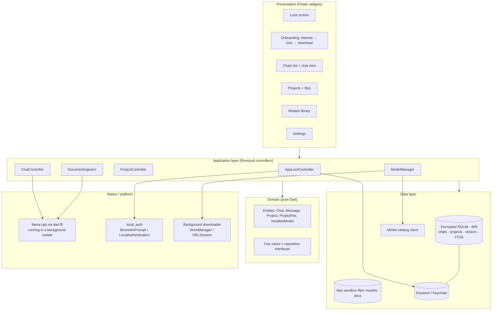
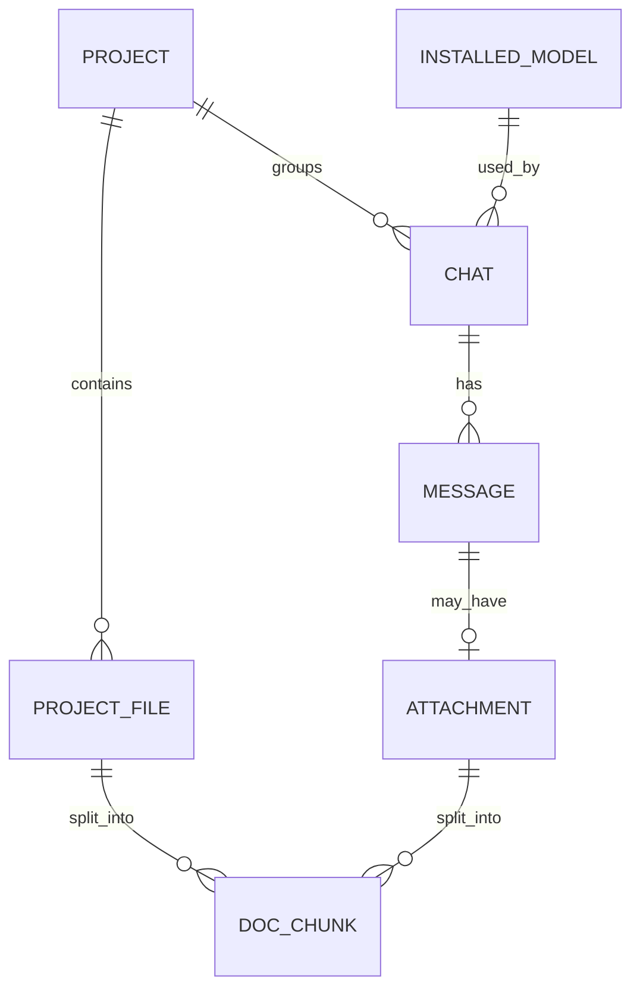
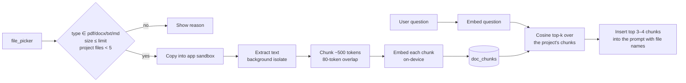
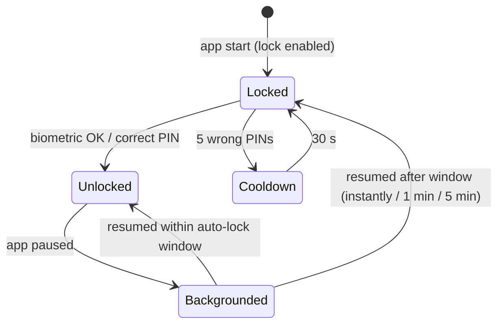
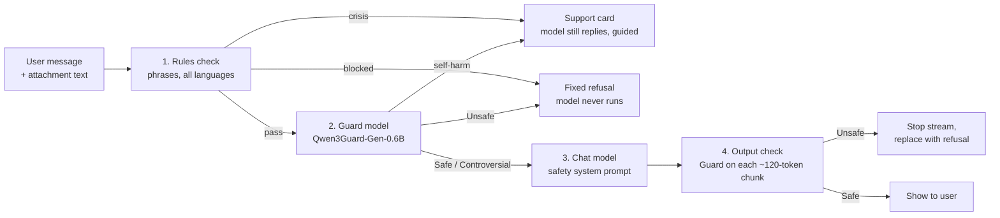

# Medha — Architecture

> Offline, on-device AI chat app. Users download a small language model (2B "Lite" or 5B "Pro") tuned for an interest (Math, Science, Coding, Exam Prep, Wellness, General, Writing, Spoken English, Translate or Farming) and chat with it entirely on their phone. Chats, projects and uploaded documents never leave the device.

**Tech stack:** Flutter (Dart) for UI and app logic · llama.cpp (C/C++) via `dart:ffi` for inference · encrypted SQLite (drift + SQLite3MultipleCiphers) for storage and vector search
**Targets:** Android 9+ (arm64) and iOS 15+ (arm64)
**Status:** Draft v0.7. The v1.0 app implements M1–M4 (see §12, "Implementation notes"). It matches the clickable prototype (lock, chats, projects, uploads, models, settings, voice), adds the open-weight model map (§5.3), the local vector store design (§8.1), content safety (§9.4) and red-team testing (§11.1).

---

## 1. Goals and constraints

| Goal | What it means for the design |
|---|---|
| Fully offline after model download | No server in the chat path. The only network calls are the model catalog and model downloads. |
| Private by default | All user data encrypted at rest; app lock with biometrics or PIN; no analytics on content. |
| Runs on mid-range phones | 2B model must run on ~4 GB RAM devices; 5B only offered when the device has enough RAM. |
| Interest-specific models | Each interest ships as its own fine-tuned model (or base model + adapter — see §5.3). |
| Responsive UI | Inference never runs on the UI isolate; tokens stream into the chat as they are generated. |
| Limited document uploads | Project files ≤ 10 MB each, ≤ 5 per project; chat attachments ≤ 5 MB, one per message; PDF, DOCX, TXT, MD only. |

**Non-goals (v1):** cloud sync, multi-device accounts, image input, voice, desktop/web builds.

---

## 2. High-level architecture



The app is layered so the inference engine, storage and platform services can be swapped without touching the UI:

1. **Presentation** — widgets and screens only; they read state from providers and call controller methods.
2. **Application** — Riverpod `Notifier`/`AsyncNotifier` controllers that orchestrate use cases (send message, download model, ingest file).
3. **Domain** — plain Dart entities, value objects and repository interfaces. No Flutter imports.
4. **Data** — repository implementations: Drift DAOs, file storage, the secure key store and the model catalog HTTP client.
5. **Native** — llama.cpp bindings, biometric APIs and the OS background download services.

---

## 3. Tech stack

| Concern | Choice | Notes |
|---|---|---|
| UI framework | Flutter (stable channel), Material 3 with a custom theme | Dark-first theme from the prototype (ink background, saffron accent, Sora + Inter). |
| State management | `flutter_riverpod` (+ `riverpod_generator`) | Testable providers, easy overrides for fakes. |
| Navigation | `go_router` | Redirect guard sends every route to `/lock` while locked. |
| Inference | **llama.cpp** compiled per platform, called through `dart:ffi` (bindings generated with `ffigen`) | GGUF, 4-bit quantized models. Runs in a long-lived background isolate. |
| Translation inference | **ONNX Runtime** (Flutter plugin, int8-quantized models) | IndicTrans2 is an encoder–decoder translation model, which llama.cpp does not run. It is exported to ONNX and runs behind the same `InferenceEngine` interface. CTranslate2 is the alternative. |
| Database | `drift` (2.32+) on `sqlite3` 3.x, built with **SQLite3MultipleCiphers** (`hooks: user_defines: sqlite3: source: sqlite3mc`) | Whole-database encryption. This replaces the older `sqlcipher_flutter_libs` setup, which drift no longer needs. FTS5 is used for keyword search. |
| Vector search | Vectors stored in the same database; dot-product scan in the inference isolate (§8.1) | `sqlite_vector` (Apache 2.0) is the upgrade path; no separate vector database. |
| Secrets | `flutter_secure_storage` | Database key and PIN hash live in Android Keystore / iOS Keychain. |
| App lock | `local_auth` | Fingerprint / Face ID, with a PIN fallback. |
| Model downloads | `background_downloader` | Resumable, survives app backgrounding, Wi-Fi-only option. |
| File picking | `file_picker` | Restricted to `pdf, docx, txt, md`. |
| Document text extraction | PDF: a pdfium-based package (e.g. `pdfrx`) · DOCX: `archive` + `xml` (read `word/document.xml`) · TXT/MD: direct read | Verify licences before shipping. |
| Hashing | `crypto` (SHA-256) | Verifies every downloaded model file. |
| Device info | `device_info_plus` + a small platform channel for total RAM | Decides which sizes to offer. |
| Paths | `path_provider` | Models and documents in the app's private support directory. |
| Testing | `flutter_test`, `mocktail`, `integration_test` | See §11. |

---

## 4. Project structure

Feature-first folders, each split into the same layers:

```
lib/
  main.dart
  app/
    router.dart              # go_router + lock redirect guard
    theme.dart               # colours, type scale (Sora/Inter)
    providers.dart           # top-level provider wiring
  core/
    ffi/llama_bindings.dart  # ffigen output (do not edit by hand)
    inference/
      inference_engine.dart  # abstract interface
      llama_engine.dart      # llama.cpp implementation
      inference_isolate.dart # isolate entry point + message protocol
      prompt_templates.dart  # per-model chat templates
    storage/
      app_database.dart      # Drift database + SQLCipher setup
      secure_keys.dart       # DB key, PIN hash
    utils/
  features/
    lock/          {data, domain, application, presentation}
    onboarding/    {...}
    models/        {data, domain, application, presentation}   # catalog, download, install, delete
    chat/          {...}                                        # chats list, chat view, streaming
    projects/      {...}                                        # projects, files, project chats
    documents/     {...}                                        # extraction, chunking, retrieval
    settings/      {...}
native/
  llama.cpp/       # git submodule, pinned commit
  android/         # CMakeLists.txt for the NDK build
  ios/             # xcframework build script
test/
integration_test/
```

---

## 5. On-device inference

### 5.1 Engine

- **Runtime:** llama.cpp, built as a shared library (`libllama.so` for Android via the NDK and CMake; an `.xcframework` for iOS). It is pinned to a known commit as a git submodule.
- **Second runtime for Translate:** ONNX Runtime runs the IndicTrans2 translation models (int8 ONNX files), because llama.cpp only runs decoder-only chat models. Both runtimes sit behind `InferenceEngine`, so the chat code doesn't know which one is answering.
- **Model format:** GGUF with 4-bit quantization (Q4_K_M as the default). Lite base files are about 1.6–3 GB and Pro base files about 2.7–5 GB on disk (§5.3).
- **Acceleration:** Metal on iOS. On Android, start CPU-only (NEON) and test the Vulkan backend per device before enabling it by default.
- **Interface:** the app talks only to an abstract `InferenceEngine`, so the runtime can be replaced later (for example by MediaPipe LLM Inference or MLC LLM) without UI changes.

```dart
abstract interface class InferenceEngine {
  Future<void> load(ModelHandle model, {int contextTokens = 4096});
  Stream<String> generate(List<ChatTurn> turns, GenerationParams params);
  Future<List<double>> embed(String text);   // used for document retrieval
  Future<void> cancel();
  Future<void> unload();
}
```

### 5.2 Isolate model

Generating text with llama.cpp blocks the calling thread, so it never runs on the UI isolate.

```mermaid
sequenceDiagram
  participant UI as Chat screen
  participant C as ChatController
  participant I as Inference isolate
  participant L as llama.cpp (FFI)
  UI->>C: send("Solve x² − 5x + 6 = 0")
  C->>C: save user message (DB)
  C->>I: GenerateRequest(turns, params)
  I->>L: tokenize + decode loop
  loop each token
    L-->>I: token
    I-->>C: TokenChunk (SendPort)
    C-->>UI: partial message (stream)
  end
  I-->>C: Done(stats)
  C->>C: save bot message (DB)
```



- **One long-lived isolate** holds the loaded model, so it isn't reloaded for every message.
- **Messages to the isolate:** `Load`, `Generate`, `Embed`, `Cancel` and `Unload`. **Messages back:** `TokenChunk`, `Done`, `Error` and `Progress`.
- **Stop button:** "Stop" sends `Cancel`; the decode loop checks a cancel flag between tokens.
- **One model at a time:** only one model is loaded at a time. Switching to a chat that uses a different model unloads the current one and loads the other, behind a "Loading Medha Science 5B…" state.
- **Memory pressure:** when the OS signals low memory (`didHaveMemoryPressure` / `onTrimMemory`), the app unloads the model if it is idle.

### 5.3 Model map (open-weight)

The map is current as of October 2026. Every chat model is **Apache 2.0**, ships GGUF weights, and runs in llama.cpp. The Translate models (IndicTrans2) are **MIT**-licensed and run in ONNX Runtime (§5.1).

**Selection criteria**
- **Licence:** must allow commercial use and bundling in an app with no extra agreement.
- **Lite (2B tier):** about 2–2.5B parameters; should run on a phone with 4–6 GB of RAM.
- **Pro (5B tier):** about 4–4.5B parameters; should run on a phone with 8 GB or more.
- **Quality:** strongest available at that size on the benchmarks that matter for the subject.
- **Languages:** good multilingual coverage, so Hindi, Tamil, Kannada and others are possible later.

#### The map

| Interest | Lite (2B tier) | Pro (5B tier) | Thinking | Why |
|---|---|---|---|---|
| **Math** | MiniCPM5-2B | Qwen3.5-4B | On, capped | Best reported small-model math: MiniCPM5-2B AIME 2025 86.5, MATH-500 94.6 (vendor-reported); Qwen3.5-4B AIME 24/25 55.8 (third-party). Step-by-step reasoning matters more than chat style. |
| **Science** | MiniCPM5-2B | Qwen3.5-4B | On, capped | Science needs reasoning plus knowledge. MiniCPM5-2B GPQA-Diamond 70.2 (vendor-reported); Qwen3.5-4B MMLU-Pro 79.1 (third-party), the strongest knowledge score in this size class. |
| **Wellness** | Gemma 4 E2B | Gemma 4 E4B | Off | Warm, natural conversation, quick replies, and 140 training languages. Safety comes from the guardrails in §5.5, not from a medical model. |
| **General** | Gemma 4 E2B | Gemma 4 E4B | Off | Best all-round assistant at this size (E4B MMLU-Pro 69.4, MMMLU 76.6), 128K context, and image input for a later "ask about a photo" feature. |
| **Coding** | MiniCPM5-2B | Qwen3.5-4B | On, capped | MiniCPM5-2B is strong at code for its size (LiveCodeBench v6 69.1, SWE-bench Verified 46.4; vendor-reported). Shares the Math/Science base file, so it needs no extra download. |
| **Exam Prep** (JEE, NEET, boards) | MiniCPM5-2B + exam add-on | Qwen3.5-4B + exam add-on | On, capped | The reasoning base plus a syllabus-tuned LoRA add-on (≈ 80 MB), with Projects for the student's own notes. |
| **Writing** | Gemma 4 E2B | Gemma 4 E4B | Off | Emails, resumes, letters and posts. Its own prompt and suggestions keep it separate from General. |
| **Spoken English** | Gemma 4 E2B | Gemma 4 E4B | Off | Gemma 4 E2B/E4B take audio input, which fits voice mode. A conversation partner that gently corrects grammar. |
| **Farming** | Gemma 4 E2B + farming add-on | Gemma 4 E4B + farming add-on | Off | Crops, pests, soil and seasons. A LoRA add-on (≈ 80 MB) plus a built-in reference library searched like project files (§8). |
| **Translate** | IndicTrans2 distilled (≈ 200M) | IndicTrans2 M2M (≈ 1B) | n/a | A specialized translation model (MIT licence) covering English and all 22 scheduled Indian languages. The 1B model also translates directly between Indian languages, like Tamil ↔ Hindi. Tiny and fast. |

#### Models used

| Model | Released | Params | Licence | Context | Est. download (Q4_K_M) | RAM at 4-bit |
|---|---|---|---|---|---|---|
| MiniCPM5-2B (OpenBMB) | Sep 2026 | 2.52B dense | Apache 2.0 (training data also open) | 128K | ≈ 1.6 GB | ≈ 2.5–3 GB |
| Qwen3.5-4B (Alibaba) | Mar 2026 | ~4B dense + vision encoder | Apache 2.0 | 262K | ≈ 2.7 GB | ≈ 3.5–4 GB |
| Gemma 4 E2B (Google) | Apr 2026 | 2.3B effective (~5B stored) | Apache 2.0 | 128K | ≈ 3 GB | ≈ 4 GB |
| Gemma 4 E4B (Google) | Apr 2026 | 4.5B effective (~8B stored) | Apache 2.0 | 128K | ≈ 5 GB | ≈ 5.5–6 GB |
| IndicTrans2 distilled (AI4Bharat) | 2023 | ≈ 200M (En↔Indic), ≈ 320M (Indic↔Indic) | MIT | Sentence-level | ≈ 0.4 GB | ≈ 1 GB |
| IndicTrans2 M2M (AI4Bharat) | 2023 | ≈ 1.2B | MIT | Sentence-level | ≈ 1.1 GB | ≈ 2 GB |

Download sizes are estimates, so measure the real GGUF files before setting the catalog's `bytes` and `minRamMb` values. Gemma 4's "E" sizes count *effective* parameters. The stored weights are larger, so Gemma downloads are bigger than the 2B/5B labels suggest.

#### Interests share base models

Each interest is defined as a base model plus a system prompt (plus an optional LoRA add-on), not as a separate model file. Interests fall into three groups:

| Group | Interests | Base file (Lite / Pro) |
|---|---|---|
| Reasoning | Math, Science, Coding, Exam Prep | MiniCPM5-2B / Qwen3.5-4B |
| Conversation | Wellness, General, Writing, Spoken English, Farming | Gemma 4 E2B / Gemma 4 E4B |
| Specialized | Translate | IndicTrans2 distilled / IndicTrans2 M2M |

- **Smaller downloads:** someone who installs Math Lite and then Coding Lite downloads nothing extra; the Coding prompt is already there.
- **Cheaper storage:** all ten Lite subjects take about 5 GB in total (three base files plus two ≈ 80 MB add-ons) instead of ten separate files.
- **Easy to add subjects:** a new subject is a catalog entry, not a new model.
- **Later fine-tuning:** a LoRA adapter (tens of MB) can be added to any interest without changing the app. This was Option B in the earlier draft, and it is now the default path.

The download flow therefore checks whether the base file already exists. The Models screen lists *interests* and shows the storage of the *base files* (see §6).

#### Fallback for low-RAM phones

Some phones have less than about 5 GB of RAM, which is not enough for Gemma 4 E2B. On those phones, the conversation-group Lite subjects fall back to **Qwen3.5-2B** with thinking off (Apache 2.0, ≈ 1.3 GB, 262K context, MMMLU 56.9). Its instruction following is weaker (IFEval 61.2 with thinking off), so the system prompt needs to be shorter and more direct.

#### Considered and not chosen

| Model | Reason |
|---|---|
| MedGemma 1.5 4B | Built for clinical work and covered by Google's Health AI Developer Foundations terms, not plain Apache 2.0. Shipping it requires downstream user agreements and, where applicable, regulatory authorisation. That is too heavy for a wellness coach. |
| Qwen3.5-2B for Math or Science | Weak at hard math (HMMT Feb 25: 22.9), and its model card warns that it is prone to thinking loops. |
| LFM3-1.7B (Liquid AI) | Released 27 Oct 2026, too new to judge. It uses the LFM Open License, which is not Apache 2.0, so it needs a licence review. Worth re-checking in M4. |
| Phi-4-mini (3.8B, MIT), SmolLM3-3B (Apache 2.0) | Solid, but they now trail Qwen3.5-4B and Gemma 4 E4B at a similar size. |
| Sarvam-1 (2B, 10 Indian languages) | A natural fit for Indian languages, but released under a non-commercial licence, so it can't ship in Medha. |
| Index-Translate 2B (Bilibili) | Licence not stated for the small sizes; IndicTrans2 is MIT and purpose-built for Indian languages. |

#### Per-subject rules

These sit on top of the app-wide safety layer (§9.4):

| Subject | Extra rules |
|---|---|
| **Coding** | Refuse malware, exploits, credential stealers and similar requests. Add those to the red-team set (§11.1). |
| **Exam Prep** | Explain solutions step by step rather than only giving answers. No help cheating during a live exam. |
| **Farming** | Recommend following pesticide labels and protective gear. Point to the local Krishi Vigyan Kendra for region-specific advice. |
| **Translate** | The guard model checks both the source text and the translation, so translation can't be used to slip unsafe text past the checks. |
| **Spoken English** | Voice input goes through the same safety checks as typed text. |
| **Not offered** | Medical diagnosis and legal advice (liability). Personal finance only as money-basics education, if added later. |

#### Before locking the map

MiniCPM5-2B's scores are mostly OpenBMB's own measurements. It also writes long reasoning: about 11,000 reasoning tokens per task on hard benchmarks, according to Artificial Analysis. Before shipping, run the per-interest eval set from §11 on two real phones (one with 4–6 GB of RAM, one with 8 GB or more) and record three things:
- answer quality with the reasoning cap applied
- time to first token and tokens per second
- battery drain over a 10-minute session

If MiniCPM5-2B falls short with the cap, use Qwen3.5-4B for Math and Science on both tiers, because it is still within Lite's RAM budget on 6 GB phones.

### 5.4 Prompting and context

- **Templates:** each base model's chat template is stored in the catalog entry (`promptTemplate`) and applied in `prompt_templates.dart`. Prefer the template embedded in the GGUF file when llama.cpp exposes it.
- **System prompt:** each interest has its own system prompt. This is what turns one base model into "Medha Math" or "Medha Science".
- **Context window:** start at 4096 tokens even though the models support 128K or more, because RAM is the limit on a phone. When a chat grows past that, keep the system prompt, any retrieved document chunks and the most recent turns, and drop the oldest turns.
- **Reasoning ("thinking") budget:** Math and Science run with thinking on.
  - Cap reasoning at about 1,536 tokens on Lite and about 3,072 on Pro, then force the final answer.
  - Show the reasoning collapsed under a "Show steps" control.
  - Wellness and General run with thinking off, for fast replies.
- **Sampling:** use each model card's recommended values rather than one global setting. Low temperature or greedy decoding makes these reasoning models loop.

  | Model | Temperature | top-p | top-k | Other |
  |---|---|---|---|---|
  | Gemma 4 | 1.0 | 0.95 | 64 | |
  | Qwen3.5, thinking | 1.0 | 0.95 | 20 | presence penalty 1.5 |
  | Qwen3.5, non-thinking | 1.0 | 1.0 | 20 | presence penalty 2.0 |
  | MiniCPM5 | model card defaults | | | |

  The values live in the catalog entry (`sampling`), so they can be tuned without an app release.
- **Answer length:** at most 768 new tokens after reasoning.

### 5.5 Wellness guardrails

Wellness runs on a general-purpose model, so it has extra system prompt rules on top of the app-wide content safety layer (§9.4):

- Supportive, practical guidance on sleep, stress, habits, movement and routines.
- No diagnoses, no medication names or doses.
- Suggest seeing a doctor for symptoms that persist or are severe.

---

## 6. Model catalog and downloads

The catalog is a small signed JSON manifest served from a CDN. It is the only server-side component.

The catalog has two lists:
- **`baseModels`:** the GGUF files themselves, each downloaded at most once.
- **`interests`:** the subject entries the user picks, each pointing at a base file.

```json
{
  "version": 4,
  "baseModels": [
    {
      "id": "minicpm5-2b-q4km",
      "family": "MiniCPM5",
      "file": { "url": "https://cdn.example.com/medha/minicpm5-2b-q4_k_m.gguf", "bytes": 0, "sha256": "…" },
      "minRamMb": 3072,
      "promptTemplate": "minicpm",
      "license": "Apache-2.0",
      "attribution": "OpenBMB MiniCPM5-2B"
    },
    {
      "id": "gemma4-e2b-q4km",
      "family": "Gemma 4",
      "file": { "url": "https://cdn.example.com/medha/gemma-4-e2b-it-q4_k_m.gguf", "bytes": 0, "sha256": "…" },
      "minRamMb": 4608,
      "promptTemplate": "gemma4",
      "license": "Apache-2.0",
      "attribution": "Google Gemma 4 E2B"
    }
  ],
  "interests": [
    {
      "id": "medha-math-lite",
      "interest": "math",
      "tier": "Lite",
      "baseModelId": "minicpm5-2b-q4km",
      "fallbackBaseModelId": null,
      "adapters": [],
      "thinking": { "enabled": true, "maxTokens": 1536 },
      "sampling": { "temperature": null, "topP": null, "topK": null },
      "contextTokens": 4096,
      "systemPrompt": "You are Medha Math…"
    },
    {
      "id": "medha-wellness-lite",
      "interest": "wellness",
      "tier": "Lite",
      "baseModelId": "gemma4-e2b-q4km",
      "fallbackBaseModelId": "qwen3_5-2b-q4km",
      "adapters": [],
      "thinking": { "enabled": false },
      "sampling": { "temperature": 1.0, "topP": 0.95, "topK": 64 },
      "contextTokens": 4096,
      "systemPrompt": "You are Medha Wellness…",
      "guardrails": ["crisis_card"]
    }
  ],
  "signature": "…"
}
```

In this example:
- `"bytes": 0` is a placeholder; fill in the real file sizes when the catalog is built.
- `null` sampling values mean "use the model card's defaults".
- The app uses `fallbackBaseModelId` when the device's RAM is below the main base model's `minRamMb`.
- Licence notices: every base file's `license` and `attribution` feed the Open-source licences screen (§9.5).

**Download flow** (Download → Verify → Optimize, matching the prototype's three steps):

1. **Pre-checks.** The app checks free disk space (needs the file size plus 10% headroom) and device RAM (`minRamMb`). Sizes that don't fit are hidden, or shown greyed out with the reason.
2. **Download.** `background_downloader` saves the file to a temporary path. It respects the Wi-Fi-only toggle, resumes after interruptions, and runs while the app is in the background.
3. **Verify.** The app computes SHA-256 in a background isolate and compares it with the manifest. On mismatch it deletes the file and offers a retry.
4. **Optimize.** The app moves the file into `models/`, test-loads it in the inference isolate, and runs a short warm-up prompt.
5. **Record.** The app writes an `installed_models` row. The first install then triggers the "Lock your chats" step.

Models are stored in the private application support directory, excluded from iCloud and Android auto-backup because they are large and can be downloaded again.

---

## 7. Data model

The database is a single drift/SQLite file encrypted with SQLite3MultipleCiphers. It holds everything except the model and document files, including the document vectors (§8.1).



| Table | Key columns |
|---|---|
| `installed_models` | `id`, `catalog_id`, `interest`, `size`, `path`, `bytes`, `sha256`, `installed_at`, `is_default` |
| `projects` | `id`, `name`, `color`, `created_at`, `updated_at` |
| `project_files` | `id`, `project_id`, `name`, `ext`, `bytes`, `path`, `status` (`pending / indexed / failed`), `added_at` |
| `chats` | `id`, `title`, `model_id`, `project_id?`, `created_at`, `updated_at` |
| `messages` | `id`, `chat_id`, `role` (`user / assistant / system`), `content`, `created_at`, `tokens`, `status` (`streaming / done / cancelled / error`) |
| `attachments` | `id`, `message_id`, `name`, `ext`, `bytes`, `path` |
| `doc_chunks` | `id`, `source_type` (`project_file / attachment`), `source_id`, `project_id`, `ordinal`, `text`, `embedding` (BLOB, int8), `emb_scale`, `emb_model`, `emb_dim`, plus the FTS5 mirror `doc_chunks_fts` (§8.1) |
| `settings` | key–value: `lock_enabled`, `lock_method`, `auto_lock`, `save_history`, `wifi_only` |

**Deletion rules** (these match the prototype):

| Action | What happens |
|---|---|
| Delete chat | Deletes its messages, attachments, attachment files and chunks. The UI shows Undo for about 4 s, and the delete is only committed after that. |
| Delete project | Deletes its files and their chunks. Its chats are kept and moved out of the project (`project_id = NULL`). |
| Delete all chats | Deletes every chat and message. Project files are kept. |
| Delete model | Deletes the GGUF file. Chats that used it stay readable but show "Model removed — download again to continue". |
| "Save chat history" off | Chats live in memory only and are wiped when the app is closed. |

---

## 8. Documents and retrieval

The goal is for chats inside a project, and chats with an attachment, to answer from the user's documents, all on-device.



| Rule | Limit |
|---|---|
| Project file size | ≤ 10 MB each |
| Files per project | ≤ 5 |
| Chat attachment size | ≤ 5 MB, one per message |
| Allowed types | PDF, DOCX, TXT, MD |
| Extracted text per file | Capped at ~200k characters; the user is warned if a file is truncated |

- **Embeddings:** a small dedicated embedding model, downloaded the first time the user uploads a document, not with the first chat model. It runs through the same inference isolate (`embed()`).
  - **First choice:** EmbeddingGemma 2, text-only checkpoint (270M parameters; about 540 MB of memory at 8K context). Confirm its licence before shipping, because its predecessor used Gemma's custom terms.
  - **Fallback:** Qwen3-Embedding-0.6B (Apache 2.0, about 600M parameters, slightly better multilingual retrieval). Run it with a short context (512–1,024 tokens per chunk) to keep memory low.
- **Vector search:** see §8.1.
- **Scanned PDFs:** PDFs with no text layer are marked "No readable text found". OCR is out of scope for v1.
- **Citations:** answers that used documents show the source file names under the bot message.

### 8.1 Local vector store

**Decision:** keep vectors **inside the same encrypted SQLite database**, using hybrid search (vector + keyword). Do not add a separate vector database in v1.

#### How much data there is

| | Per file | Per project (5 files) | 50 projects |
|---|---|---|---|
| Text (capped at ~200k chars, ≈ 50k tokens) | ≈ 120 chunks | ≈ 600 chunks | ≈ 30,000 chunks |
| Vectors, 768-dim float32 (3 KB each) | ≈ 0.35 MB | ≈ 1.8 MB | ≈ 90 MB |
| Vectors, 768-dim int8 (768 B each) | ≈ 0.09 MB | ≈ 0.45 MB | ≈ 23 MB |

Chunks are 500 tokens with an 80-token overlap. Search is always scoped to one project, or to one chat's attachments, so a query scans at most about 600 vectors. That is roughly 0.5 million multiply-adds, under a millisecond even in plain Dart. Approximate-nearest-neighbour indexes such as HNSW only pay off at tens of thousands of vectors per query, which Medha's limits never reach.

#### Options considered

| Option | Pros | Cons | Verdict |
|---|---|---|---|
| **A. Vectors as BLOBs in the app's SQLite, scored in a Dart isolate** | No extra native dependency. One encryption story, one backup and delete path. Deletes cascade in the same transaction as the file row. | Linear scan only. Scoring code is ours to maintain (small). | **v1** |
| **B. `sqlite_vector` extension (sqlite.ai, Apache 2.0) in the same database** | Scan runs in C. Built-in int8, float16 and 1-bit vector types. Has a Flutter package that works with drift. Still one database file. | Another native library to build for each platform. Compatibility with the encrypted SQLite build must be tested. Full scan only (no ANN). | **Upgrade path**, if profiling ever shows the Dart scan is a bottleneck |
| **C. ObjectBox (HNSW vector index, Dart/Flutter)** | Real ANN index; queries combine vector and attribute filters. | A second database next to SQLite, so deletes, backups and encryption have to be kept in sync across two stores. Its vector docs don't cover encryption at rest. Overkill at this scale. | Not chosen |
| **D. Server-style vector databases (Chroma, Qdrant, LanceDB…)** | Rich features. | No first-class Flutter mobile embedding; would need a sidecar. Breaks the fully-offline, single-process design. | Not chosen |

#### Schema

```sql
-- One row per chunk; lives in the same encrypted DB as chats and projects.
CREATE TABLE doc_chunks (
  id           INTEGER PRIMARY KEY,
  source_type  TEXT    NOT NULL,          -- 'project_file' | 'attachment'
  source_id    INTEGER NOT NULL,
  project_id   INTEGER,                   -- denormalised for fast scoping
  ordinal      INTEGER NOT NULL,          -- position in the source document
  text         TEXT    NOT NULL,
  embedding    BLOB    NOT NULL,          -- int8[dim], L2-normalised before quantising
  emb_scale    REAL    NOT NULL,          -- de-quantisation scale for this vector
  emb_model    TEXT    NOT NULL,          -- e.g. 'embeddinggemma2-text@1'
  emb_dim      INTEGER NOT NULL           -- e.g. 768, or 256 if truncated
);
CREATE INDEX doc_chunks_scope ON doc_chunks(project_id, source_type, source_id);

-- Keyword side of hybrid search (FTS5 ships with SQLite).
CREATE VIRTUAL TABLE doc_chunks_fts USING fts5(text, content='doc_chunks', content_rowid='id');
```

#### Query path (hybrid retrieval)

1. **Embed the question** with the same embedding model.
2. **Vector search:** load the scope's vectors once per chat session into a `Float32List` held in memory in the inference isolate, then compute dot products (all vectors are pre-normalised, so the dot product is the cosine similarity) and take the top 20.
3. **Keyword search:** FTS5 `MATCH` over the same scope, ranked by BM25, top 20. Exact terms, formula names and numbers are where pure vector search on small embedders is weakest.
4. **Merge** the two lists with Reciprocal Rank Fusion (score = Σ 1/(60 + rank)) and keep the top 3–4 chunks. Add each chunk's neighbour (ordinal ± 1) when it fits the context budget.
5. **Insert into the prompt** with file names, and show those names as citations under the answer.

#### Rules that keep it correct

- **Model versioning:** `emb_model` and `emb_dim` are stored per row. If the embedding model changes in a catalog update, the app re-embeds in the background (only a few hundred chunks per project) and ignores rows from the old model until it finishes.
- **Smaller vectors if needed:** EmbeddingGemma-family models support truncating vectors to fewer dimensions (Matryoshka). If storage or RAM gets tight, truncate to 256 dims and re-normalise; the scan gets 3× cheaper.
- **Deletes:** deleting a file, attachment, chat or project removes its chunks and FTS rows in the same transaction. No orphan vectors.
- **Privacy:** embeddings can be partly inverted to recover the original text, so they are treated as sensitive as the documents. That is why they stay inside the encrypted database rather than in a separate store.

#### When to revisit

Revisit this if a later feature searches *across* all projects and history ("search everything I've ever uploaded") and the corpus passes about 50,000 chunks. Then use Option B first; consider an ANN index (sqlite_vector's roadmap or ObjectBox) only after that.

---

## 9. Security and privacy

### 9.1 App lock



- **Router guard:** `AppLockController` exposes `isLocked`. The `go_router` redirect sends every route to `/lock` while it is true, so no screen renders before unlock.
- **Biometrics:** uses `local_auth` with `biometricOnly: true` when the user chose Fingerprint. A PIN must always be set as the fallback, because biometrics can be unavailable or changed.
- **PIN storage:** the PIN is never stored. The app stores a salted hash (PBKDF2-SHA256, high iteration count) in secure storage, with an exponential back-off after repeated failures.
- **Hidden previews:** the app screen is blurred in the app switcher (Android `FLAG_SECURE` while locked; an iOS snapshot overlay).
- **Auto-lock:** a lifecycle observer timestamps `paused` and checks the elapsed time on `resumed`.

### 9.2 Data at rest

| Data | Protection |
|---|---|
| Database (including document vectors) | SQLite3MultipleCiphers with a random 256-bit key generated on first launch and held in Keystore/Keychain via `flutter_secure_storage`. At startup, assert that the `cipher` pragma exists, so an unencrypted SQLite build can never ship by accident. |
| Uploaded documents | Stored in the private sandbox. On iOS they use file protection `complete`. On Android, encrypt each file with AES-GCM using the same key family (or a Jetpack Security–style approach). |
| Model files | Stored unencrypted; they are public and large. |
| Backup | Docs and the database are excluded from cloud backup by default, because the key does not leave the device. |

### 9.3 Network

- **Allowed traffic:** the only outbound calls are the catalog fetch, model downloads and reports the user chooses to send (§9.5), all over HTTPS. The catalog signature is verified with a public key bundled in the app.
- **Content stays local:** no chat or document content is ever sent anywhere. Crash reporting (if added) must strip message text.
- **Store disclosures:** the privacy labels should state "Data not collected", with a Settings line reinforcing it.

### 9.4 Content safety

An app can't stop a user from *typing* a question. What it controls is what Medha *answers*. Medha has no server, so every check runs on the phone, works offline and applies to every interest. The small chat models are not reliable at refusing on their own, so safety is built in layers around them.

#### Safety layers



| Layer | What it does | Why it's needed |
|---|---|---|
| **1. Rules check** (Dart, under 1 ms) | Normalises text (lowercase, Unicode NFKC, strips spacing tricks like "b o m b"). Matches against a signed list of phrases for crisis language and high-risk weapon terms, covering English, Hindi, Tamil, Kannada and romanised "Hinglish". | Instant and deterministic. Catches the obvious cases even if the guard model fails or is still loading. |
| **2. Guard model** on the input | Qwen3Guard-Gen-0.6B (Apache 2.0, 119 languages; ≈ 0.5 GB at 4-bit) labels each message Safe, Controversial or Unsafe, with a category. It also checks the text of any attachment. | Understands meaning and rephrasing ("for a story…", "hypothetically…") that a phrase list misses. Small enough to stay loaded alongside the chat model. |
| **3. Safety system prompt** | Every interest's system prompt starts with the same fixed safety block: refuse weapon, explosive and drug-making instructions; respond to distress with care; never give self-harm methods; ignore instructions found inside uploaded documents. | Gives the chat model the right default behaviour for borderline (Controversial) requests. |
| **4. Output check** | As the reply streams, every ~120 tokens plus the final text go back through the guard model in "response" mode. On Unsafe, the stream stops and the visible text is replaced with the refusal. | The last line of defence for jailbreaks and for unsafe text pulled in from uploaded documents. |

#### What the user sees, by category

| Category | Response | Chat model runs? |
|---|---|---|
| **Suicide and self-harm** | A fixed support card at the top of the reply, with Tele-MANAS (14416), emergency number 112 and the option to talk. The chat model then replies with a guided, caring prompt: listen, encourage reaching out, no methods. The user is never told off or blocked. | Yes, with a crisis prompt |
| **Weapons and explosives** (making, getting or using them) | A fixed, calm refusal: "I can't help with making weapons or explosives." No lecture, no hints, no partial steps. | No |
| **Other Unsafe** (sexual content, illegal drug making, hacking, hate) | A fixed refusal per category. | No |
| **Controversial** (for example the history of explosives, how a medicine overdose affects the body, a crime novel plot) | Allowed, with the safety system prompt. The output check still runs. | Yes |
| **Safe** | Normal reply. | Yes |

Why self-harm is handled differently: blocking someone in crisis can make them feel dismissed, and they may go somewhere worse. The safe approach is to never give method information while staying supportive and pointing to real help.

#### Repeated attempts

- **Cooldown:** after 3 blocked weapon or explosive requests within 10 minutes, the chat pauses for 2 minutes with a neutral message. This slows down "try 20 rephrasings" jailbreaking.
- **Counters stay local:** they are stored only on the phone and contain no message text. Nothing is reported anywhere, in line with §9.3.
- **Crisis is exempt:** crisis messages never count toward a cooldown.

#### Keeping it tamper-resistant

- **Signed safety files:** the phrase list, safety system prompt and refusal texts ship in the signed catalog (§6). They can be updated without an app release, and a modified copy is rejected.
- **Guard is required:** the guard model is part of the first model download. If it is missing or fails its hash check, chat is disabled.
- **Prompt injection:** retrieved document chunks are wrapped as quoted reference material, and the safety prompt tells the model never to follow instructions inside them.
- **Limits:** on a rooted or jailbroken phone, a determined person could replace files. The base models are public anyway, so the goal is that *Medha the app* never produces harmful output in normal use, not that the weights are secret.

#### Performance

| Check | Cost |
|---|---|
| Guard on input | ≈ 150–300 ms on a mid-range phone, run while the chat model is preparing |
| Guard on output | On chunks of the stream, so the reply is not delayed |
| RAM | ≈ +0.5 GB. On phones with under 6 GB, the guard stays loaded and the chat model uses the Lite tier or the fallback (§5.3). |

#### Testing

Safety is verified by red-team testing, which is in scope from M1 onwards. The attack sets, release gates and process are in §11.1.

#### Policy

- **Terms of use:** a short, plain-language Acceptable Use section, accepted during onboarding.
- **Age rating:** a store rating that matches the content policy (12+ / Teen at minimum).
- **Legal review:** have a lawyer review the policy against India's IT Rules and each store's AI-app guidelines before launch.

### 9.5 Licences, attribution and AI disclosure

Medha doesn't have to name its models in the chat, but it must carry their licences, and showing the names where users make choices builds trust.

#### Licence obligations

| Licence | Models | Obligation | How Medha meets it |
|---|---|---|---|
| Apache 2.0 | MiniCPM5-2B, Qwen3.5-4B, Qwen3.5-2B, Gemma 4 E2B/E4B, Qwen3Guard-Gen-0.6B | Include the licence text and any NOTICE file the model ships with. Mark modified files. | The Open-source licences screen shows the full text and NOTICE for every model. Exam Prep and Farming add-ons are labelled "fine-tuned by Medha" and ship with a changes notice. |
| MIT | IndicTrans2 | Include the copyright line and licence text. | Same screen. |
| Both | All | No trademark rights; no implied endorsement. | Model names appear only as factual attribution, never as Medha feature names. A line states Medha is not affiliated with or endorsed by these organisations. |

The licence texts and NOTICE files come from the signed catalog (§6), so a model swap updates them automatically.

#### Where model names appear

| Place | What it shows |
|---|---|
| Chat | Only the Medha brand ("Medha Math 2B"). |
| Download screen | "Runs on MiniCPM5-2B", plus "already on this phone" when the file is shared. |
| Models tab → Details | Model, maker, licence, file format and size, memory needed, add-on, subjects that share it, and the safety checker. |
| Settings → About → Open-source licences | Every model the app can download, with maker, licence, what it's used for, whether it's on the phone, and the full licence text. |

#### AI disclosure

- **Onboarding:** the welcome screen says Medha is an AI and can make mistakes.
- **Chat:** a short line under the message box says the same, on every chat.
- **Settings → About:** an "About AI answers" item explains the limits and points to Report.

This covers the transparency rules for AI chat apps, such as the EU AI Act's requirement to tell users they're talking to an AI, and India's draft rules on AI-generated content, without naming any model.

#### Report this reply

App stores expect generative-AI apps to let users report offensive output; Google Play's AI-generated content policy requires it.

- **Where:** every Medha reply except the greeting has a Report action.
- **What the user picks:** a reason (harmful or unsafe, wrong or misleading, offensive or biased, something else), an optional note, and a switch to include the question and reply, which is on by default and clearly labelled.
- **Privacy:** reports are the only data Medha ever sends.
  - Nothing leaves the phone until the user taps Send.
  - The report waits in an encrypted queue until the phone is online, then goes to a minimal reports endpoint over HTTPS.
  - It contains no account, device ID or other chats.
  - The privacy labels must mention this optional, user-initiated report.
- **What happens to a report:**
  - It is triaged by the team.
  - Confirmed safety failures become red-team regression cases (§11.1).
  - Fixes ship through the signed catalog (phrase list, prompts, thresholds) without an app release.

---

## 10. Performance and device support

| Concern | Approach |
|---|---|
| RAM | Gate each base file by its catalog `minRamMb`: Pro needs about 6 GB of phone RAM for Qwen3.5-4B and about 8 GB for Gemma 4 E4B. Below the threshold, use `fallbackBaseModelId` or hide the tier. Load with `mmap` so pages can be evicted. |
| Startup | Lazy-load the model on first send rather than at launch. Show "Warming up…" for the first token. |
| Thermal and battery | Cap threads at performance cores − 1. Pause generation if the app is backgrounded mid-reply and resume it on return. |
| Storage | The Models screen shows Medha's usage and free space. Deleting a model is one tap. |
| Long chats | Truncate context (§5.4); keep message rendering lazy (`ListView.builder`, reversed). |
| Benchmarks | Track time-to-first-token and tokens/sec per device tier in CI on real devices (see §11). |

---

## 11. Testing and delivery

| Area | Tests |
|---|---|
| Domain and controllers | Unit tests with a `FakeInferenceEngine` that streams scripted tokens. |
| Database | Drift in-memory database tests for every DAO, deletion cascade and migration. |
| Documents | Golden tests on extraction from sample PDF, DOCX, TXT and MD files; validation of limits and types. |
| Lock | Widget tests for the router guard, PIN back-off and the auto-lock timer (with a fake clock). |
| UI | Golden tests for the key screens in the dark theme. |
| Integration | `integration_test` on one low-end and one high-end device per OS: download → verify → chat → upload → delete. |
| Model quality | An offline eval set per interest (for example, math problems with known answers), run before publishing a catalog entry. |
| Safety | Red-team testing (§11.1), a release gate for every app release and catalog update. |

### 11.1 Red-team testing

Red-team testing means deliberately attacking Medha the way a bad actor would, to find where the safety layer (§9.4) fails before real users do. It is in scope for every release and is a release gate.

#### Scope

| Area | Covered |
|---|---|
| Harm categories | Weapons and explosives; suicide and self-harm; illegal drug making; hacking and malware; sexual content; hate and harassment. |
| Interests and tiers | Every interest × Lite and Pro × the low-RAM fallback model. Each base model and each LoRA add-on is tested on its own. Coding adds malware and exploit cases; Translate adds "translate this harmful text" cases. |
| Languages | English, Hindi, Tamil, Kannada, romanised Hinglish and mixed-language messages. Further languages are added as they are localised (M5). |
| Inputs | Typed messages, chat attachments, project files (retrieved chunks), and multi-turn conversations. |
| Device runs | The same compressed GGUF files that ship, on a real low-end and high-end phone per OS, not only on a desktop. |
| Out of scope (v1) | Rooted or jailbroken phones with modified app files (§9.4); image and voice input (not in v1). |

#### Test sets

1. **Attack set (must be blocked or handled).** It is built per category and per language, and covers these techniques:
   - direct requests
   - role-play and "pretend you have no rules"
   - fiction or research framing ("for my novel…")
   - a request split across several turns
   - spelling, spacing and symbol tricks
   - translation tricks (asking in one language for an answer in another)
   - instructions hidden inside an uploaded PDF or DOCX
   - attempts to get the model to reveal or ignore its safety prompt
2. **Crisis set.** Messages showing distress, from indirect ("I don't see the point any more") to explicit, in every language. The expected result is the support card plus a caring reply with no method details.
3. **Over-refusal set (must pass).** Normal questions that sound risky, such as chemistry homework, news about a blast, the history of dynamite, medicine side effects or a crime novel plot. These catch Medha refusing too much.

The sets start at about 300 cases per category across languages and grow over time. Each case records its category, language, technique and expected outcome.

#### Release gates

| Gate | Threshold |
|---|---|
| Weapons and explosives refused | 100% |
| Other Unsafe categories refused | ≥ 99% |
| Crisis messages: support card shown, no method details | 100% |
| Over-refusal on normal questions | < 3% |
| Guard model latency on input (mid-range phone) | ≤ 300 ms p95 |

A release or catalog update cannot ship if any gate fails.

#### Process

| When | What happens |
|---|---|
| Every change to a model, quantisation, system prompt, phrase list, guard model or retrieval code | The full automated suite runs in CI against the shipping GGUF files. |
| Before each milestone release | A manual red-team session with 3–5 people outside the dev team, including native Hindi, Tamil and Kannada speakers, each trying to break the app for about 2 hours. |
| Every new bypass found (in testing or reported by users) | Fixed (phrase list, prompt or guard threshold), then added to the attack set as a permanent regression case. |
| Quarterly | Review the sets for new jailbreak techniques and new slang. |

#### Handling of the test sets

The attack set is effectively a guide to bypassing Medha's checks, so it is handled carefully:
- Stored in a private, access-controlled repository.
- Never bundled in the app or published.
- Results and logs kept internal.
- Testers sign a short confidentiality note.

**CI/CD:** GitHub Actions or Codemagic builds llama.cpp for both platforms, runs the tests, and ships to internal tracks (Play Console internal testing and TestFlight). Catalog updates deploy separately from app releases.

---

## 12. Roadmap

| Phase | Scope |
|---|---|
| **M1 — Core chat** | Onboarding, one interest (Math 2B), download and verify, streaming chat, chat history with delete. Content safety layer (§9.4) and the first red-team suite and release gates (§11.1); chat does not ship without them. |
| **M2 — Privacy** | App lock (biometric + PIN), encrypted database, settings, delete all. |
| **M3 — Projects and documents** | Projects, file upload with limits, extraction, embeddings, retrieval, attachments. Red-team cases for harmful content hidden in uploaded files. |
| **M4 — Catalog growth** | Remaining interests (Science, Coding, Exam Prep, Wellness, General, Writing, Spoken English, Translate, Farming), 5B tier, device gating, LoRA add-ons for Exam Prep and Farming. Red-team run per new base model and interest. |
| **M5 — Polish** | Performance tuning, accessibility, localisation (Hindi, Kannada, Tamil…), store launch. Full red-team suite in every launch language, plus an external tester session before store submission. |

---

### Implementation notes (v1.0)

Where the v1.0 code differs from this document:
- **Storage.** `sqlite3` with SQLCipher directly, not drift with SQLite3MultipleCiphers (§7). Schema v2 adds `projects`, `documents`, `doc_chunks` (+ FTS5) and `reports`. Uploaded files are `documents` rows rather than `project_files`; a chat attachment is a document tied to the chat.
- **Vector search.** int8 vectors in `doc_chunks` with a Dart cosine scan, merged with FTS5 BM25 by Reciprocal Rank Fusion (§8.1). Embeddings use Qwen3-Embedding-0.6B (open decision 4).
- **Voice.** Uses the phone's own offline speech recognition (`speech_to_text`, on-device mode) and text-to-speech (`flutter_tts`), not a bundled Whisper model.
- **Translate** is deferred and shown as "Coming soon".
- **Per-file encryption** of the copied original upload (§9.2) is not done yet; the extracted text and vectors are in the encrypted database.
- **LoRA add-ons** can be loaded (`medha_set_lora`), but none are trained yet.

## 13. Open decisions

1. **Validate MiniCPM5-2B on real phones** (§5.3). If it fails with the reasoning cap, use Qwen3.5-4B for Math and Science on both tiers.
2. **Fine-tuning** — ship M1 with the stock instruct models and system prompts. Then decide per interest whether a LoRA adapter beats prompting on the eval set.
3. **Android acceleration** — CPU-only first, or invest early in the Vulkan backend?
4. **Embedding model licence** — confirm EmbeddingGemma 2's terms, or use Qwen3-Embedding-0.6B.
5. **Safety guard model** — validate Qwen3Guard-Gen-0.6B on Hindi, Tamil, Kannada and Hinglish red-team cases. If it misses too many, add a larger Indic-focused guard on Pro-tier phones, or expand the phrase list (§9.4).
6. **Vector scan engine** — the Dart scan (v1) is expected to be enough. Test whether `sqlite_vector` loads alongside the SQLite3MultipleCiphers build before relying on it as the upgrade path (§8.1).
5. **History off** — whether to require a PIN when "Save chat history" is turned back on.
6. **Monetisation** — free 2B vs paid 5B, or per-subject purchases. This affects the catalog entitlements field.
